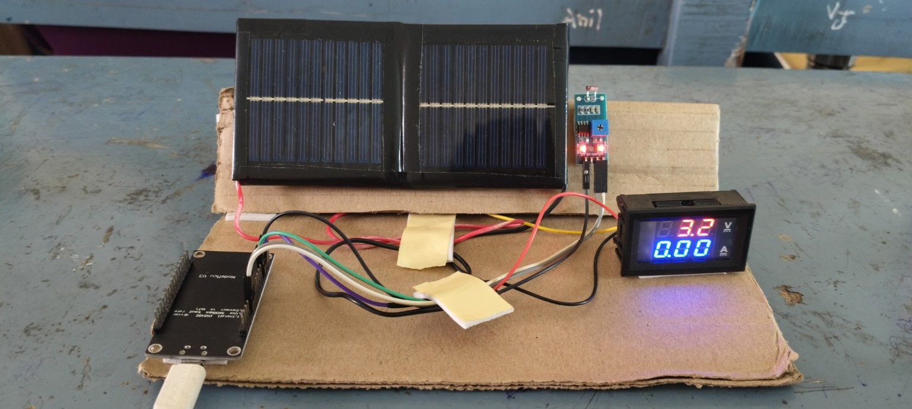

# Fault-Tolerant Solar Panel Monitoring System Using Predictive Modeling

A low-cost ESP32-based solar monitoring prototype designed to improve monitoring reliability when the primary voltage measurement becomes unreliable.

## Project Overview

Solar-panel voltage can be affected by sensor faults, loose connections, electrical noise, or damaged sensing hardware. A wrong voltage reading can lead to incorrect conclusions about the condition of the panel.

This project introduces a simple software-based fault-detection approach. The ESP32 monitors the solar-panel voltage together with light intensity from an LDR. Since solar output generally changes with available light, the LDR provides an independent reference for checking whether the voltage reading is reasonable.

When the measured voltage and light condition are consistent, the system operates normally. When a significant mismatch is detected, the system flags a possible voltage-sensor fault and uses the LDR as a backup reference for continued monitoring.

The current prototype focuses on the hardware monitoring and fault-detection concept. AI/ML-based voltage prediction using historical data is planned as future work.

## Key Features

- Real-time solar-panel voltage monitoring
- LDR-based light-intensity monitoring
- Cross-check between voltage and light conditions
- Basic voltage-sensor fault detection
- ESP32-based embedded implementation
- Low-cost hardware prototype
- Web-based monitoring dashboard in the prototype
- Historical-data collection planned for future prediction

## System Architecture

```text
                 +----------------+
                 |  Solar Panel   |
                 +-------+--------+
                         |
              +----------+----------+
              |                     |
              v                     v
       Voltage Measurement        LDR
              |                     |
              v                     v
             +-----------------------+
             |         ESP32         |
             |                       |
             |  Read + Compare Data  |
             +-----------+-----------+
                         |
                +--------+--------+
                |                 |
              Normal             Fault
                |                 |
                v                 v
        Measured Voltage    LDR Backup Reference
                |                 |
                +--------+--------+
                         |
                         v
                 Monitoring Dashboard
```

## Hardware

| Component | Purpose |
|---|---|
| ESP32 development board | Data acquisition and processing |
| Small solar panel | Source being monitored |
| LDR sensor module | Relative light-intensity reference |
| Digital V/A display | Local voltage/current reference display |
| Jumper wires | Electrical connections |
| Voltage-divider resistors | Safe voltage scaling for ESP32 ADC input |

> Important: The solar-panel voltage should be scaled to a safe ESP32 ADC level before connecting it to an ESP32 analog input. The exact resistor values and pin assignments should match the actual prototype wiring.

## Current Working Concept

1. The solar panel generates voltage depending on illumination.
2. The ESP32 reads the voltage measurement.
3. The LDR provides a relative light-intensity value.
4. The system compares the voltage reading with the light condition.
5. A reasonable relationship is treated as normal operation.
6. A large unexpected mismatch is treated as a possible voltage-sensor fault.
7. During a detected fault, the LDR is used as an independent backup reference rather than treating it as a direct voltage sensor.
8. The monitoring interface displays the available readings and status.

## AI/ML Future Work

The current system uses the LDR as a backup reference. This approach is useful for fault detection, but it does not directly reconstruct an accurate voltage value.

The next version will collect historical data such as:

- Timestamp
- Light intensity
- Measured voltage
- Operating conditions

A machine-learning model such as **Linear Regression** can first be trained on this historical data to estimate expected solar voltage from the available features.

```text
Historical Data
      |
      v
Data Cleaning
      |
      v
Feature Selection
      |
      v
Linear Regression Model
      |
      v
Predicted Voltage
      |
      v
Fault-Time Backup Estimation
```

More advanced regression or time-series models can be evaluated later if the collected dataset justifies them.

## Current Status

**Prototype stage**

Implemented in the example firmware:
- ESP32-based monitoring
- Solar panel voltage monitoring through an ADC voltage divider
- LDR-based light monitoring
- LDR-based fault reference
- Local ESP32 Wi-Fi dashboard
- Hardware demonstration

Planned:
- Formal fault-injection testing
- Automatic fault thresholds
- Historical data logging
- Linear Regression voltage prediction
- Cloud storage and remote monitoring
- Model evaluation using MAE/RMSE/R²

## Limitations

- An LDR provides relative light intensity, not calibrated solar irradiance.
- Solar voltage also depends on panel characteristics, temperature, load, wiring, and operating conditions.
- Therefore, LDR readings should not be treated as a direct replacement for a voltage measurement.
- Fault thresholds require calibration for the specific solar panel and operating setup.
- The AI/ML prediction component is future work in the current project version.

## Project Images

### Hardware Prototype



## Repository Structure

```text
Fault-Tolerant-Solar-Monitor/
│
├── README.md
├── LICENSE
├── .gitignore
│
├── images/
│   └── hardware-prototype.jpg
│
├── docs/
│   ├── architecture.md
│   └── testing.md
│
└── src/
    ├── solar_monitor.ino
    └── README.md
```

## Technologies

- ESP32
- Embedded C/C++ / Arduino framework
- LDR sensor
- Solar photovoltaic panel
- Analog voltage measurement
- Web dashboard
- Python / scikit-learn planned for future ML prediction

## Future Scope

- Historical-data logging
- Linear Regression-based voltage prediction
- Automatic sensor-fault classification
- Temperature as an additional feature
- Cloud-based data storage
- Remote alerts
- More advanced regression/time-series models
- Performance evaluation under different lighting and load conditions

## Author

**Nalabolu Pavani**  
B.Tech - Artificial Intelligence and Data Science  
IFET College of Engineering
